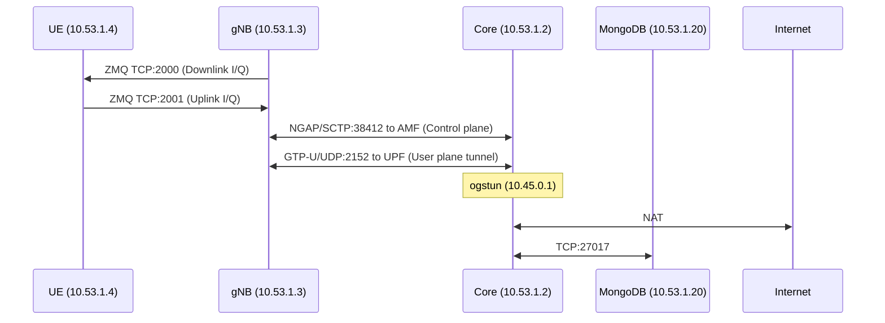

# 5. Inter-Container Communication

| Link | Protocol | Port | Direction | Carries |
| :--- | :--- | :--- | :--- | :--- |
| UE ↔ gNB (DL) | ZMQ/TCP | 2000 | gNB → UE | Downlink I/Q radio samples |
| UE ↔ gNB (UL) | ZMQ/TCP | 2001 | UE → gNB | Uplink I/Q radio samples |
| gNB ↔ AMF | NGAP/SCTP | 38412 | Bidirectional | Control signaling (registration, session setup) |
| gNB ↔ UPF | GTP-U/UDP | 2152 | Bidirectional | Tunneled UE data packets |
| Core ↔ MongoDB | TCP | 27017 | Bidirectional | Subscriber record queries |
| UPF ↔ Internet | NAT | — | Bidirectional | UE traffic after GTP-U decapsulation |
